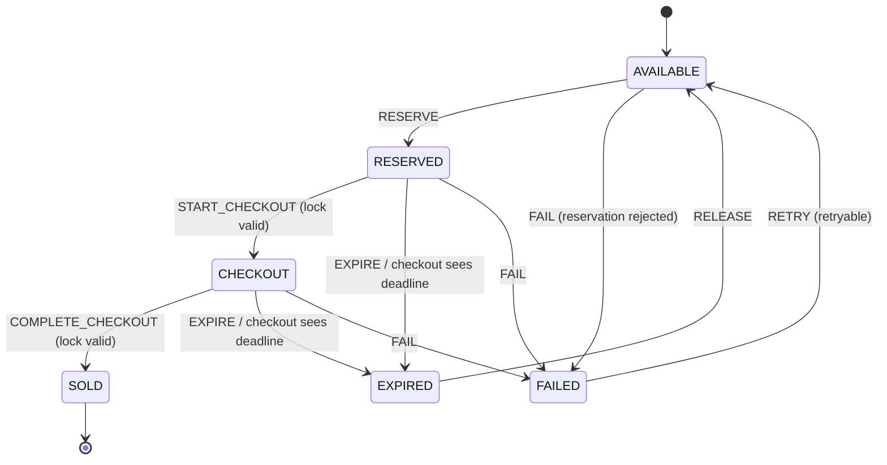

# 11.11 Flash Sale

A Vite + TypeScript simulation of a Vietnam midnight flash sale. It has product cards, integer-VND prices, a fixed-date countdown, idempotent inventory reservations, expiring locks, and checkout.

## Run it

```sh
npm install
npm run dev
```

Production build and preview:

```sh
npm run build
npm run preview
```

Run the Node built-in tests with Node 24 or later:

```sh
node --disable-warning=MODULE_TYPELESS_PACKAGE_JSON --test
```

## State machine



`transition(state, event)` is pure. Time-sensitive events carry an explicit server timestamp. A failed checkout retains the reservation ID so the caller can release its inventory lock before returning to `AVAILABLE`; the next attempt must reserve again. `SOLD` is terminal.

## Design decisions

- **Sale deadline:** The fixed target is `2026-11-11T00:00:00+07:00`. The countdown recomputes remaining time from `Date.now()` deltas in a `requestAnimationFrame` loop, sends UI updates only when the displayed second changes, pauses while the document is hidden, and recomputes on `visibilitychange` when visible.
- **Money:** Product prices are validated as safe integer VND and displayed with `Intl.NumberFormat('vi-VN', { style: 'currency', currency: 'VND' })`.
- **Reservation API:** The in-memory API returns server time and absolute `expiresAt`, accepts an idempotency key, and may reject requests. Rejection leaves authoritative stock unchanged so the UI can roll back its optimistic decrement.
- **Expiry:** Each API registers a sweep callback with one shared 250 ms interval ticker. The ticker fans out to all product reservation maps; there is no timeout per reservation. API reads also sweep expired locks. A lock releases stock once; checkout consumes it without returning stock.
- **Stock ownership:** The simulated API is authoritative for available stock. It decrements stock only when accepting a new reservation, increments only when releasing or expiring a lock, and returns current stock in results.
- **Stable product identity:** Product card DOM elements are stored in a `Map` keyed by `product.id`, so cards are reused by product identity rather than list position.
- **Rollback demonstration:** The first reservation attempt for the Pulse Smart Watch is deliberately rejected. Its card shows the optimistic stock change roll back and permits a new attempt.
- **Scope:** The API is an in-memory teaching simulation. Reloading resets inventory; it does not provide cross-process locking, durable orders, or real payment processing.

## Verification notes

The AI-generated failure cases caught during implementation and the corrective evidence are recorded in [AI_FAILURE_AUDIT.md](./AI_FAILURE_AUDIT.md). The remaining work is tracked in [TASK_DECOMPOSITION.md](./TASK_DECOMPOSITION.md).
